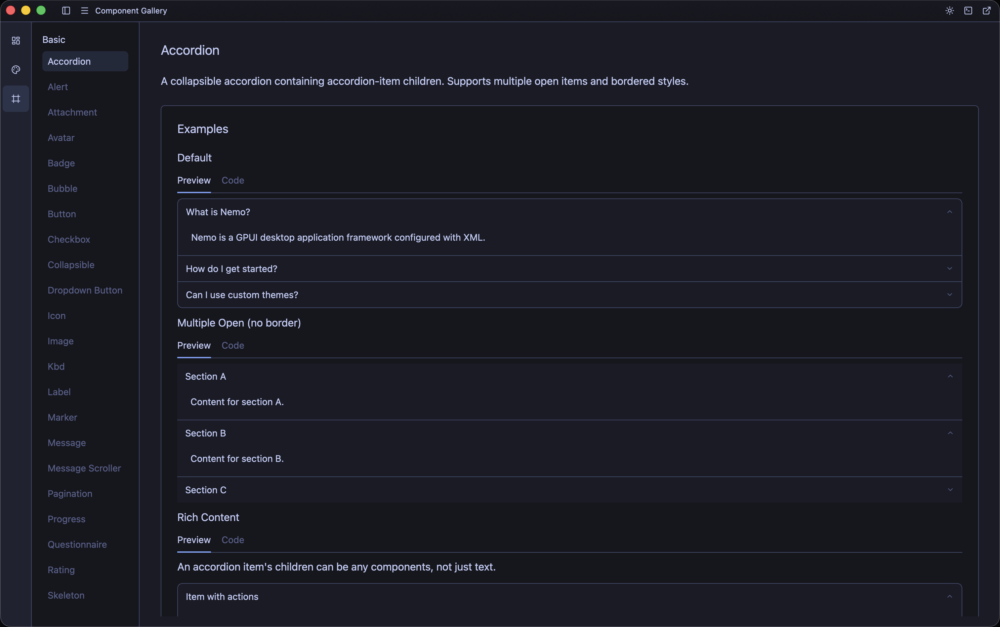

# Component Gallery Example

An interactive showcase of every built-in Nemo component, hosted in an app-shell
with an Overview / Styling / Components section menu and a sidebar-driven
component router.



## Run

```sh
cargo run -- --app-config examples/components/app.nemo
```

## What It Shows

- App-shell layout: `<app-shell>` with `<sidenav-item>` page switching, a
  `<header-bar>` with theme toggle, and a component `<page>` containing the
  gallery router
- Sidebar navigation via the chrome-free page router: a `<router>` of `<route>`s
  with a `<nav-link>` per component page — no navigation handler required
- The router mounts only the active route's body — pages are unmounted when
  not shown, rather than built-and-hidden
- Every component page is a reusable `<component-page-*>` template that pairs
  live examples with copy-ready markup in Preview/Code tabs
- Modal open/close toggling through `get_component_property` and
  `set_component_property`

## Components

Basic: accordion, alert, avatar, badge, bubble, button, calendar, carousel,
collapsible, command, dropdown-button, icon, image, kbd, label, marker, message,
pagination, rating, skeleton, spinner, stepper, tag, text, tooltip.

Form: checkbox, code-editor, input, radio, select, slider, switch, text-editor,
textarea, toggle.

Layout: list, modal, notification, panel & stack.

Advanced: charts, menu, svg, table, tree.

Navigation: sidenav-bar.

## Placeholder pages

gpui-kit components that Nemo does not wrap yet show a "Not implemented"
placeholder with a link to the component's page on
[gpui-kit.com](https://gpui-kit.com):

- attachment
- calendar
- carousel
- command
- data-table
- diff
- dock
- message-scroller
- questionnaire
- settings
- virtual-list